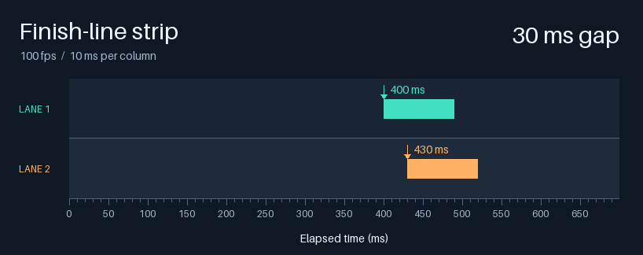

# Finish-line strip

A Python and Pillow photo-finish demo. A fixed camera renders two racers at 100 frames per second. The generator keeps the same one-pixel-wide vertical slice at the finish line from every frame, then places those slices side by side.



The horizontal axis measures elapsed time. Each slice represents 10 ms and is enlarged to 10 pixels for display. The vertical axis shows position across the two lanes. Each color band covers the time its racer occupies the finish line, and the arrow marks its first occupied sample.

## Run locally

Use Python 3.10 or later.

```sh
python -m pip install -r requirements.txt
python -m finish_line_strip generate
python -m finish_line_strip read finish.png
```

```text
Lane 1: frame 40 (400 ms)
Lane 2: frame 43 (430 ms)
Gap: 30 ms
```

Pass an output path and two zero-based arrival frames to generate a different race. The allowed range is 0 through 69.

```sh
python -m finish_line_strip generate tie.png --arrivals 40 40
python -m finish_line_strip read tie.png
```

The PNG stores the plot geometry, lane colors, and sample period as metadata. The reader finds each arrival by scanning the saved image pixels. It expects a PNG created by this tool with its metadata intact.

## Verify

```sh
python -m unittest discover -s tests -v
```
